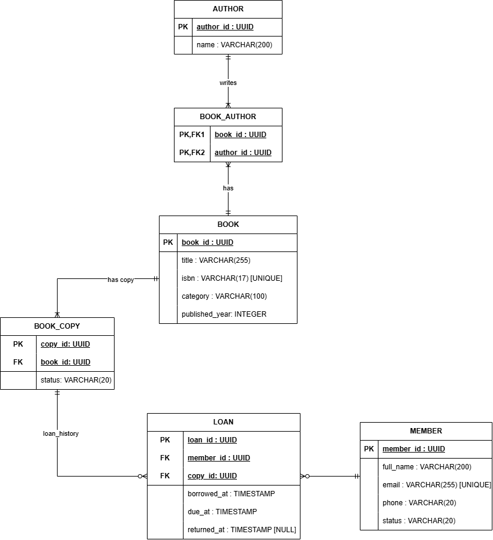

# Bài 1 — Resource Design: Hệ thống quản lý thư viện

## 1. Giới thiệu

Bài tập tập trung vào thiết kế tài nguyên (Resource Design) cho một hệ thống quản lý thư viện, sử dụng các nguyên tắc thiết kế RESTful API và mô hình hóa dữ liệu.

**Mục tiêu:**
- Xây dựng sơ đồ thực thể – mối quan hệ (ERD).
- Xác định tập tài nguyên (Resource Set) của hệ thống.
- Thiết kế danh sách từ 12 đến 20 API endpoints.
- Xây dựng JSON Schema cho 3 tài nguyên chính.

## 2. Mô tả hệ thống

Hệ thống quản lý thư viện hỗ trợ quản lý thông tin đầu sách, tác giả, các bản sao sách vật lý, độc giả và hoạt động mượn/trả sách.

Các chức năng chính:
- Quản lý thông tin sách và tác giả.
- Theo dõi từng bản sao vật lý của một đầu sách.
- Quản lý thông tin độc giả.
- Ghi nhận lượt mượn và trả sách.
- Tra cứu lịch sử mượn sách.

### Phạm vi và giả định nghiệp vụ

- Một đầu sách có thể có nhiều tác giả; một tác giả có thể viết nhiều đầu sách.
- Một đầu sách có thể có nhiều bản sao vật lý.
- Mỗi bản sao thuộc về đúng một đầu sách.
- Một độc giả có thể có nhiều lượt mượn.
- Mỗi lượt mượn gắn với đúng một độc giả và một bản sao sách.
- Một bản sao không được có nhiều lượt mượn chưa trả cùng lúc.
- Lịch sử mượn/trả được lưu lại sau khi giao dịch hoàn tất.

Các chức năng đăng nhập, đặt trước sách, tính tiền phạt và thanh toán không thuộc phạm vi của phiên bản này.

## 3. Sơ đồ ERD

ERD gồm 6 thực thể:

| Thực thể | Mô tả |
|---|---|
| `BOOK` | Lưu thông tin chung của một đầu sách. |
| `AUTHOR` | Lưu thông tin tác giả. |
| `BOOK_AUTHOR` | Bảng nối thể hiện quan hệ nhiều-nhiều giữa sách và tác giả. |
| `BOOK_COPY` | Đại diện cho từng bản sao sách vật lý. |
| `MEMBER` | Lưu thông tin độc giả. |
| `LOAN` | Lưu thông tin các lượt mượn và trả sách. |

### Sơ đồ

Draw.io: [`library-erd.drawio`](https://viewer.diagrams.net/?tags=%7B%7D&lightbox=1&highlight=0000ff&edit=_blank&layers=1&nav=1&title=Library_ERD.drawio&dark=auto#R%3Cmxfile%3E%3Cdiagram%20name%3D%22Page-1%22%20id%3D%22nqQPDCGRyHt-RbbYkq0T%22%3E7V1tk6K4Fv41XXX3w3QBii8f1bZn5q5O99rde2c%2BdUWJyl4kFsRtnV%2B%2FCSQoAhodQtRNVdcMCSGGnCfnOSc5CXe13mL9OQDL%2BRA50LuzDGd9V3u4syzTsurkP5qziXMaVjvOmAWuwwptM17cn5BlGix35TowTBXECHnYXaYzJ8j34QSn8kAQoI90sSny0r%2B6BDOYyXiZAC%2Bb%2Bz%2FXwfM4t2Ub2%2Fwv0J3N%2BS%2BbBruzALwwywjnwEEfO1m1%2Fl2tFyCE46vFugc92nm8X%2BLnHgvuJg0LoI9FHvhzvXx6Gr3B4eL7%2B%2Ff%2FQvBltfrjUzNbC6s4xBveB6TlS3qJwZhmdUMMAsxEVTNIBul8DFwfBiTDjNKeB5ahGxWPc%2Bau5wzABq0wr4inulN3DZ1RLClalghtQCqjSVr5lFT%2BwhpDbwPPnfnkekJaTH%2BxG8CQtGUAQsxKzPHCY5fxu%2FwNvBV7l%2B7T0%2B8sEwYYrnfemXXbZ4gWEAcbUmS%2BK9kWk%2BPHFgZWjeWxaggu4jQDe73B7gOGwllS91ZQ5ILJ6gS5tbJyOyTfImGOKCC7cxS4P6kIPdbluwKO0h%2FuwgM%2BQTpw9rK6KBrZkaBcz%2BshD1EU%2BMiHGSDQQk6Alq8gmEHMMpbI9XHUPXaX%2FJEO6xn39p1N2tojaXObJn%2B0eIB7yA9xQABH64BE7h%2BQyr6L0ZJV6sEprz9gIqTXY4QxWhRB4yxY1A6gYpMuUjoI2oIgaBWCgDyKXeCNiOYE%2FsyLRRYpUrAVWY5cc3s66d39bt8fwYj08dSLdOHcdRxIRnP3Y%2B5i%2BLIEE1rog3DJkXH8fN4ozhHXIfGwyrb9c3JtwCNKygeYDJSV74QZmSftPB8GpnElOOCaOy7bDYm0XX82iJ9s7AHFLgkoJDVG6P%2FvpAsJQdY65N%2B3t68PpQ12I00B5aIpqb1KOOVYFppbxLnFqJJbpBkYpiWIArPYXqxGq0DH5fWVRS6aWrhwa9eCgqPcUgYusIsjQcU08mdn1PvSGf3Hsu3fNJ0UIqOu6eRq6KQtjU5sUUVS13Ryu3TSuBYUVEIntLvCsZ8hFLP5G82zu2%2Ffvv7x1o8UjKaXAqTkzGBqerlQejEtafwiOiFqFuNA88vV84vojKhyFFTFL%2BRvQrp8hiL579GMYWi%2FpRAilqjrq4nlAojFlkUslqj7yvGiieUGicUSdV%2BVo6AqYlmuxp4bzqHzvoEgiInl67fX%2Fuf%2BSHNKodlhs2lS6GSiTrIBGGgVTOAhrDUyWKP18gU0Bp%2BAvg3knEJU%2BxzNkA%2B8AYpwReX7F8R4w7gIrDBKS5%2B0K9h8p8%2Ff2zz5g%2BscmnhYp1KbJOV0aAAOSfZHpC2vaAj8TXzj0fVSRLgtuAC%2B8xQ1PLqxUzB%2BWcyJrahXau18sAXQA9j9O93tEua5mAJID%2B27JArouGlqZ6fSqVgHYAy9tGQykTB0zLkT4HXYjQUZ4JGiiUJkdtRM2iJ4yBvjHwHRCaHwWM7tXvaIcW%2FUm%2B0UYX86IABW%2BTNt404RNJ2GRPIytHvOtNRtR0F13l6%2FPJ2nqNtZVZqERnFFbe5ZZ%2FuqtjzrTHT2J0dXaitdttmX4EJ2IJQlOvtjqfb7dSiUXDtddAJIORCUxEIR446oOFmhUIkTLsVez7j4FcCpJmq0aXpRMAm0Ty%2FSYqFqohFxvJF6DugGuaVmXQsKqpoD8sEiJxqqxFWFG2SUHAPlplzNPBhlsEM34bxX64NaLVnsUBc1ErjstZGQVV9VMFBl7mhd1F6oq2YKEXf01MFN3dHe4%2B9mWWI7ZNadrvT3a6tA59dFDQflcCjFKT0VLzJ35yQBR2sZWMqEM1UBJtGwBM02xTOeKthGmndaF41QqKtem5bINqWJ7frZRjRUQTkclLCN5CnQm%2BMbO8d4%2BZc6rL2n5x9nASWR264s22mkWHtsIc05sUUNCC55bUAoclfbFbmrtqgBYatmDFkGhDYdYvmKmg7KgaDEdJig5YYaDuVbDTWpVoOCtRJbdKOfJhnFXmq7Ii%2FVFo3UsouX0q%2BXZB41ySTyFY3VUg4EpbOhmmSOI0k02EuTzGV5MtJOmeCYPo6I4snxiwnUOVVzaIbhKBBdflWOgrMCdU7HBXlBgFfhfpxOeWE6N0ctjRxP%2BKZmPTMoGfaH3TO37uWejLs%2FEb43v9kybFkcIOp6chlrqyDrekojl%2F15bmmTmg1Rf7Oh2s3QW0LkqnJRf1M5EJRsCVnAxRjKWw%2FdW%2BUqOYB335GoAk6iTqemFxXnguwvo8qil6aop9lQ7WPoLSHylEFT1NNUjoJKtoRMV573Ln9TyM1xStPSnHI9nCJt9rIpfOJY8Xy25pSr5xTh87JVo6ASToEL4HpZPomOXJdyRO4N0otoWI%2BmlwugF3ln5DZFZ0abxTjQ%2FHL1%2FCJ8YLZqFFTCL8s5bVrWX9HuSjEwhGdUNZ9cAJ9IOxq3KToV2lT94TnNJ%2FK0AV%2F8vXwUVMInLNRCE8opEDpwCO5NRFsIxekMnjrfzsJI8q3sXRbgezn49rJG%2BsvETXlfehLej9w6IuN%2Fs3lQBfUkGJEdi2EK70lOwHPR0Rh6i9kvQEH8E2CqoaAk%2Ft9DwJcXjZEmhZLjNNt25XBqia6caa65LK6RFpjREl1E49C5KabR%2B8y28hU2Q1UDQQnPFMX9NcCClvfH4c5jmnmyqBE1aTXzqN3hvM880hzflqhl21K9sKKZR65qEF1hUw6EGztG4%2FZIRnSlTZPMZbk38oI4WqKLbi3Vyy16i7M8xcCNmMtHQSVbnMeIfj8QOu8AJ%2B7M69dh%2F%2BW1M3zW9FKIItHtC5peLoxepMV0tEUnVNvFkND0cvX0IjqJqhwFldCLs4IFzKJnywSX%2FQxhg0VTzWVRjbTv5piGqPmRoEeTzQ2SjWmI2hzqcVAJ3QQQrwK%2F0Juhu56%2BvQ0Gpe55ujnC4Yda00%2Bn73RNfpAhWgUTeKC2nE8l0Hr5zCiDUkDfBnK6IVp%2FjmbIB94ARRij8v8LYrxhNAVWGKXRQdoVbL7T5%2B9tnvzBNRBNPKxTqU2ScjrUASbJ%2FmgBfOcpag%2FJfnS9FENui5Emv6Ih8Df81k7R%2BGUx57yiXmnmYy33S%2FDlswfnqfQov0vC349rEzsbYESlOgBj6KUFkwn2pEPOnQCvw24syFiPdE4UBbqjcdK2wkPecJ%2BDUHgc5%2FYte%2BSTcW%2FUePgDY%2B9PB7qf1f5MW7hTBE2nIRG7lDHZKHFMmvnSu8gxuTvYDo7K7eA9c0zGR52eDBzTrLePIIU0Emx2CjBkZ4HEEWymDUmbRSBvQRXXWDLEmr%2BsFbLHQCnTCgZdKytLOdTr%2FCisTarEheiGVom6IedgT7m6IaUZtopCRDf8hAGqSDm0zgAOIRWjfgwpv6obWu0qdAO3an9BN2RXU1TohihGeO6GGAWlaQfbaKZNhwPnc1avHRpWidohJ%2ByiQu1wVDeQ1DMMXNJn0U6mcw38lF4518I%2FxZo4wcQnyQAhvAsS4gvPh8ih46j%2FDw%3D%3D%3C%2Fdiagram%3E%3C%2Fmxfile%3E).

### Các quan hệ chính

- `BOOK` – `BOOK_AUTHOR`: quan hệ một-nhiều.
- `AUTHOR` – `BOOK_AUTHOR`: quan hệ một-nhiều.
- `BOOK` – `BOOK_COPY`: quan hệ một-nhiều.
- `MEMBER` – `LOAN`: quan hệ một-nhiều.
- `BOOK_COPY` – `LOAN`: quan hệ một-nhiều theo lịch sử mượn.

Quan hệ nhiều-nhiều giữa `BOOK` và `AUTHOR` được triển khai thông qua bảng nối `BOOK_AUTHOR`, với khóa chính ghép gồm `book_id` và `author_id`.

## 4. Tập tài nguyên (Resource Set)

API sử dụng các tài nguyên chính sau:

| Tài nguyên | URL cơ sở | Mục đích |
|---|---|---|
| Sách (`Books`) | `/api/v1/books` | Quản lý thông tin đầu sách. |
| Tác giả (`Authors`) | `/api/v1/authors` | Quản lý thông tin tác giả. |
| Bản sao sách (`Book Copies`) | `/api/v1/book-copies` | Quản lý từng cuốn sách vật lý. |
| Độc giả (`Members`) | `/api/v1/members` | Quản lý thông tin độc giả. |
| Lượt mượn (`Loans`) | `/api/v1/loans` | Quản lý lượt mượn và trả sách. |

Quan hệ giữa sách và tác giả được truy cập thông qua các endpoint lồng nhau của tài nguyên sách, thay vì cung cấp một URL cơ sở riêng cho bảng nối `BOOK_AUTHOR`.

## 5. Danh sách API endpoints

API sử dụng tiền tố `/api/v1` để thể hiện phiên bản. Các URL dưới đây là thiết kế đề xuất, không phải các endpoint đã được triển khai.

| STT | HTTP Method | Endpoint | Mô tả |
|---:|---|---|---|
| 1 | GET | `/api/v1/books` | Lấy danh sách sách. |
| 2 | POST | `/api/v1/books` | Tạo đầu sách mới. |
| 3 | GET | `/api/v1/books/{bookId}` | Lấy thông tin chi tiết một đầu sách. |
| 4 | PATCH | `/api/v1/books/{bookId}` | Cập nhật một phần thông tin sách. |
| 5 | DELETE | `/api/v1/books/{bookId}` | Xóa đầu sách khi đáp ứng điều kiện nghiệp vụ. |
| 6 | GET | `/api/v1/authors` | Lấy danh sách tác giả. |
| 7 | POST | `/api/v1/authors` | Tạo tác giả mới. |
| 8 | GET | `/api/v1/authors/{authorId}` | Lấy thông tin chi tiết tác giả. |
| 9 | GET | `/api/v1/books/{bookId}/authors` | Lấy danh sách tác giả của một đầu sách. |
| 10 | PUT | `/api/v1/books/{bookId}/authors/{authorId}` | Thiết lập liên kết giữa sách và tác giả. |
| 11 | GET | `/api/v1/members` | Lấy danh sách độc giả. |
| 12 | POST | `/api/v1/members` | Đăng ký độc giả mới. |
| 13 | GET | `/api/v1/members/{memberId}` | Lấy thông tin chi tiết độc giả. |
| 14 | PATCH | `/api/v1/members/{memberId}` | Cập nhật thông tin độc giả. |
| 15 | GET | `/api/v1/book-copies/{copyId}` | Lấy thông tin chi tiết một bản sao sách. |
| 16 | GET | `/api/v1/loans` | Tra cứu và lọc các lượt mượn. |
| 17 | POST | `/api/v1/loans` | Tạo lượt mượn sách. |
| 18 | POST | `/api/v1/loans/{loanId}/return` | Ghi nhận việc trả sách. |

**Tổng số: 18 endpoints**, đáp ứng yêu cầu từ 12 đến 20 endpoints.

## 6. JSON Schema

Các JSON Schema mô tả cấu trúc dữ liệu và các quy tắc kiểm tra cơ bản cho ba tài nguyên chính.

| Tài nguyên | File | Mô tả |
|---|---|---|
| Book | [`book.schema.json`](schemas/book.schema.json) | Cấu trúc dữ liệu của đầu sách. |
| Member | [`member.schema.json`](schemas/member.schema.json) | Cấu trúc dữ liệu của độc giả. |
| Loan | [`loan.schema.json`](schemas/loan.schema.json) | Cấu trúc dữ liệu của lượt mượn. |

Các schema quy định kiểu dữ liệu, trường bắt buộc và những ràng buộc phù hợp với từng tài nguyên. Chúng cần được giữ nhất quán với mô hình ERD.

## 7. Các quyết định thiết kế

### 7.1. Tách đầu sách và bản sao sách

`BOOK` lưu thông tin chung của đầu sách, trong khi `BOOK_COPY` đại diện cho từng cuốn sách vật lý. Cách thiết kế này cho phép quản lý tình trạng và lịch sử mượn của từng cuốn riêng biệt.

### 7.2. Sử dụng bảng nối cho quan hệ sách – tác giả

Do một đầu sách có thể có nhiều tác giả và một tác giả có thể viết nhiều đầu sách, quan hệ nhiều-nhiều được triển khai thông qua `BOOK_AUTHOR`. Hai trường `book_id` và `author_id` đồng thời tạo thành khóa chính ghép và là các khóa ngoại tham chiếu đến hai bảng tương ứng.

### 7.3. Lưu lịch sử mượn/trả

`LOAN` lưu thời điểm mượn, hạn trả và thời điểm trả thực tế. Trường `returned_at` cho phép nhận giá trị `NULL` khi lượt mượn chưa hoàn tất. Các bản ghi cũ được giữ lại để phục vụ tra cứu lịch sử.
