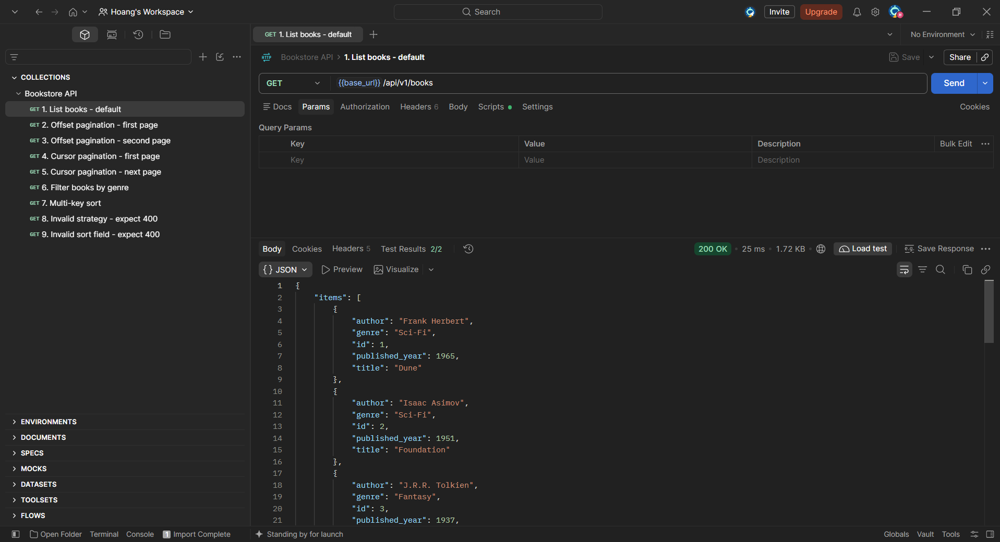
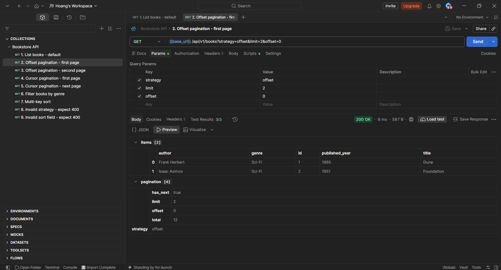
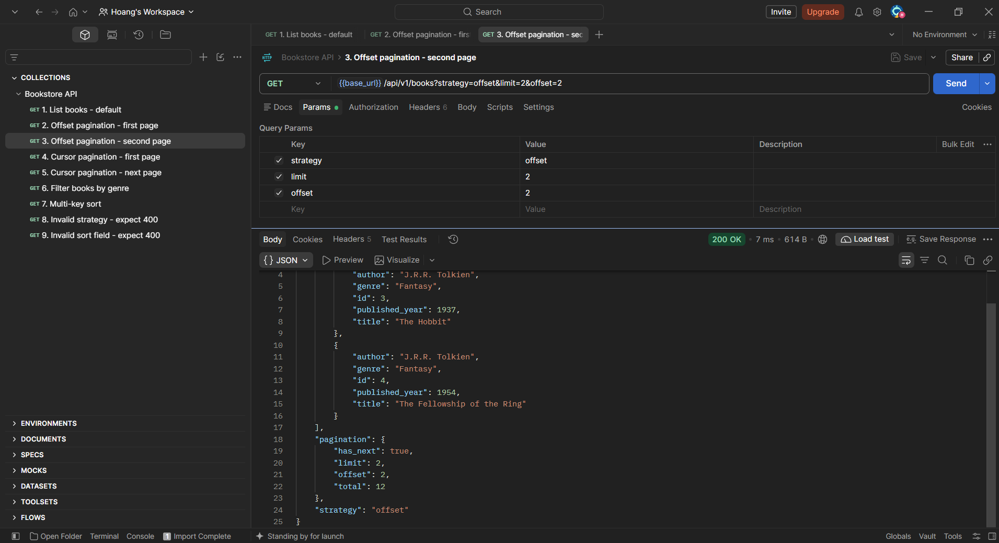
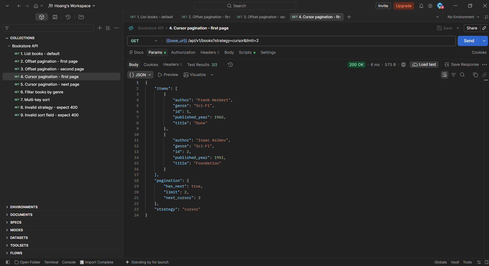
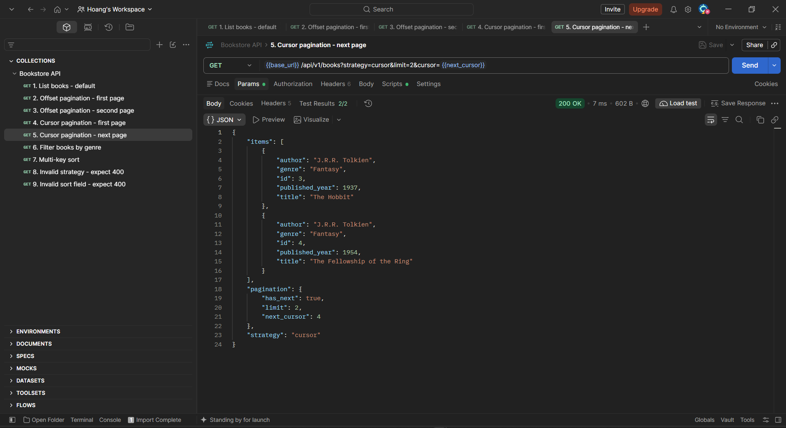
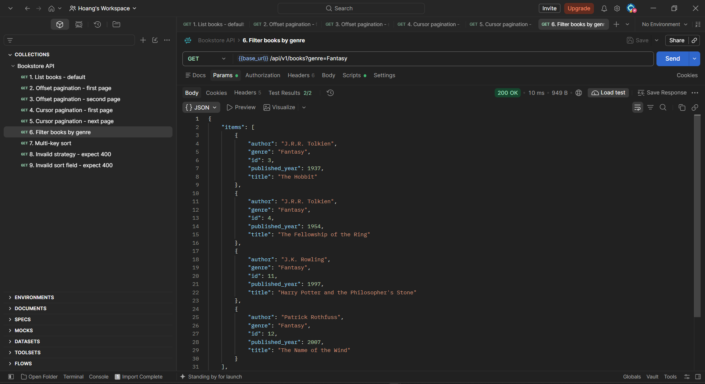
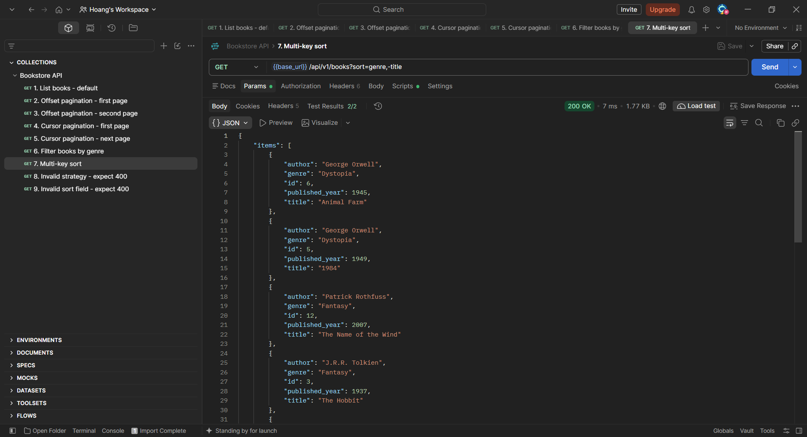
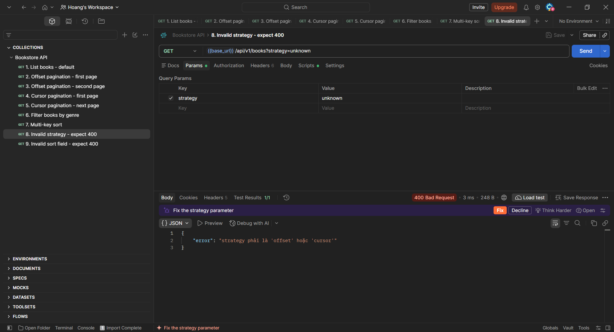
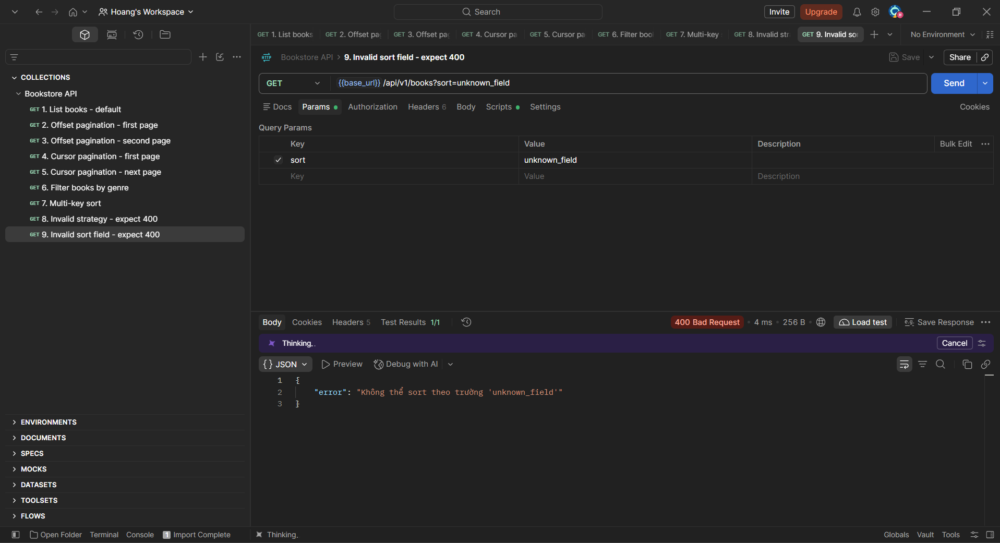

# Bookstore API — Flask Pagination

## 1. Giới thiệu

Project triển khai API quản lý danh sách sách bằng Flask và Flask-SQLAlchemy, tập trung vào các chức năng:

- Offset pagination.
- Cursor pagination.
- Lọc sách theo thể loại (`genre`).
- Sắp xếp theo nhiều trường (`multi-key sort`).
- Kiểm thử tự động bằng pytest.

## 2. Công nghệ sử dụng

- Python
- Flask
- Flask-SQLAlchemy
- SQLite
- pytest

## 3. API danh sách sách

Endpoint:

```http
GET /api/v1/books
```

### Offset pagination

```http
GET /api/v1/books?strategy=offset&limit=10&offset=0
```

- `limit`: số sách tối đa mỗi trang.
- `offset`: số bản ghi bỏ qua trước khi lấy trang.
- `strategy`: chọn chiến lược phân trang.

### Cursor pagination

```http
GET /api/v1/books?strategy=cursor&limit=10
```

Dùng giá trị `next_cursor` trong response để lấy trang tiếp theo:

```http
GET /api/v1/books?strategy=cursor&limit=10&cursor=10
```

### Lọc theo thể loại

```http
GET /api/v1/books?genre=Fantasy
```

### Sắp xếp nhiều trường

```http
GET /api/v1/books?sort=genre,-title
```

Dấu `-` trước tên trường biểu thị thứ tự giảm dần. Ví dụ trên sắp xếp `genre` tăng dần và `title` giảm dần.

### Kết hợp các tham số

```http
GET /api/v1/books?strategy=offset&genre=Fantasy&sort=-published_year,title&limit=5&offset=0
```

## 4. Postman collection

File collection được lưu tại:

`postman/bookstore-api.postman_collection.json`

- List books


- Offset pagination - first page


- Offset pagination - second page


- Cursor pagination - first page


- Cursor pagination - next page


- Filter books by genre


- Multi-key sort


- Invalid strategy - expect 400


- Invalid sort field - expect 400
