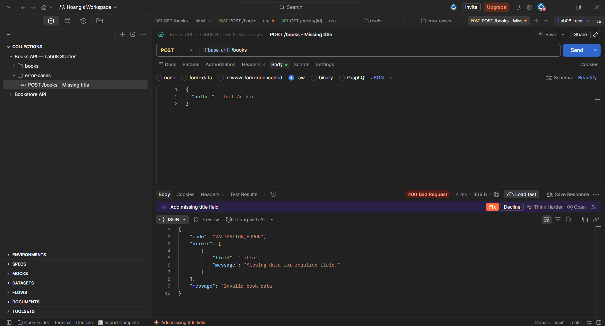
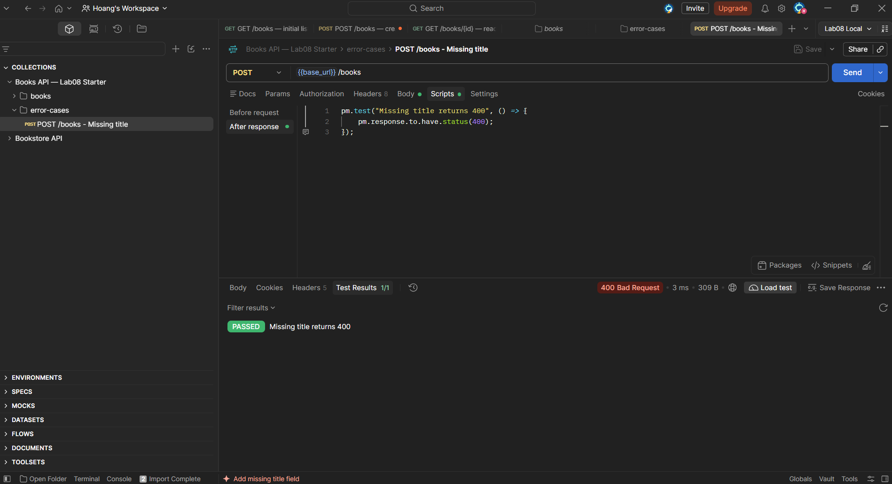
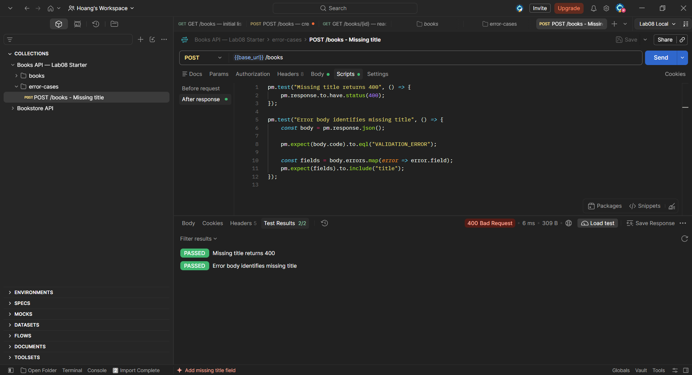
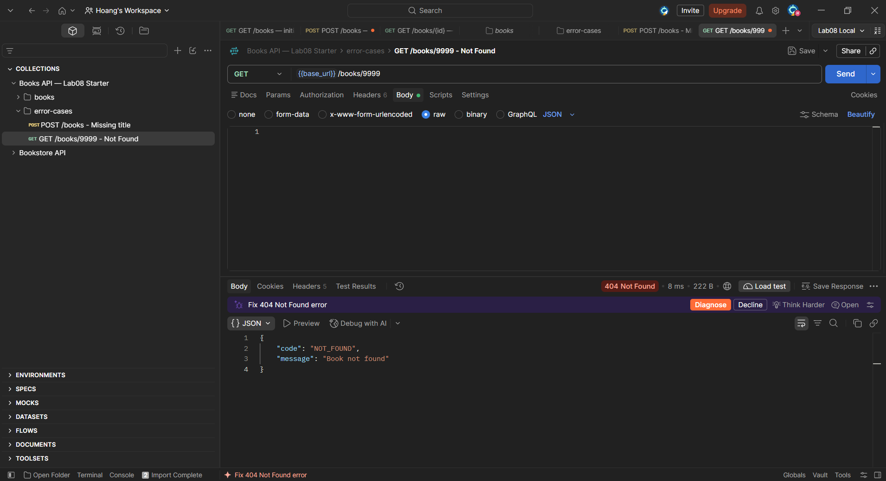
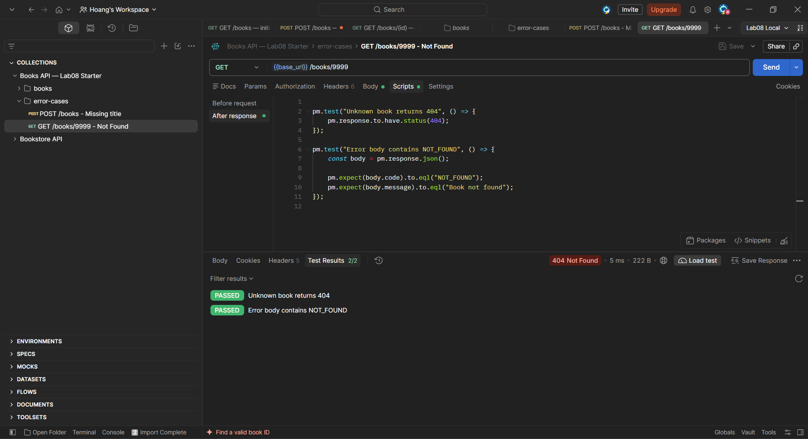
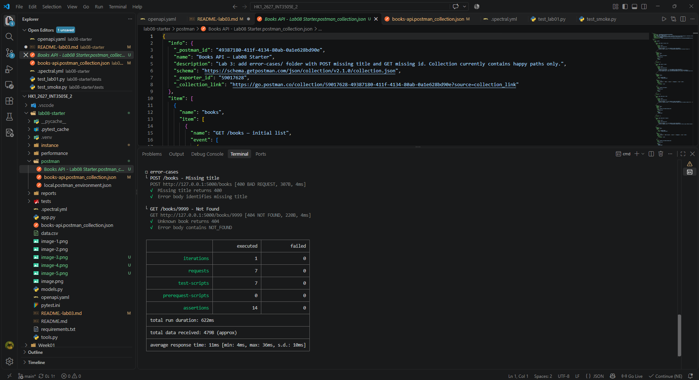

# Lab 3 — Postman & Newman API Testing

## Mục tiêu

Tự động kiểm thử Books API bằng Postman Collection và Newman CLI.

## Yêu cầu

- Python và các thư viện trong `requirements.txt`
- Node.js và Newman 6.2.3
- Flask Books API chạy tại `http://127.0.0.1:5000`

## Cách chạy

### 1. Khởi động Flask API

Từ thư mục `lab08-starter`, mở CMD:

```bat
.venv\Scripts\activate.bat
python -m app --port 5000
```

Giữ terminal Flask hoạt động.

### 2. Chạy Newman

Mở CMD thứ hai trong thư mục `lab08-starter`:

```bat
newman run postman\books-api.postman_collection.json -e postman\local.postman_environment.json
```

### 3. Xuất báo cáo JUnit

```bat
newman run postman\books-api.postman_collection.json -e postman\local.postman_environment.json -r cli,junit --reporter-junit-export reports\junit.xml
```

## Kết quả kiểm thử đã ghi nhận

- 7 HTTP requests
- 14 assertions
- 0 failures
- Thời gian chạy Newman: 622 ms (lần chạy kiểm tra trước khi xuất JUnit)

## Các kịch bản kiểm thử

- GET /books — 200
- POST /books — 201
- GET /books/{id} — 200
- PUT /books/{id} — 200
- DELETE /books/{id} — 204
- POST /books thiếu title — 400
- GET /books/9999 — 404

Báo cáo kiểm thử: `reports/junit.xml`.










